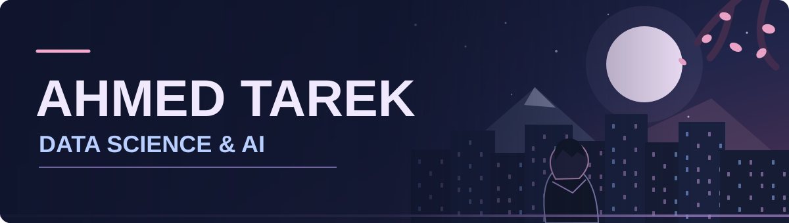

<div align="center">




<br/>


</div>


## 🌸 About me

Hey I'm Ahmed, a Computer Science student studying Data Science and AI at Elsewedy University of Technology in Egypt

I like turning messy data into something useful. Right now I'm digging into machine learning, NLP, RAG and AI agents, and I try to build a little something every time I learn a new idea

My goal is simple, be a better version of myself every single day

```python
ahmed = {
    "name": "Ahmed Tarek",
    "alias": "VectorForge",
    "currently_into": ["Machine Learning", "NLP", "RAG", "AI Agents"],
    "learning": ["Deep Learning", "PyTorch", "AI Orchestration"],
    "power_level": "still training"
}
```


## ⚔️ My toolkit

<div align="center">


</div>


## 📊 Stats

<div align="center">


</div>


## 🎴 Things I've built

<div align="center">

<a href="https://github.com/AhmedTarekOfficial/Ai-content-operational-"></a>
<a href="https://github.com/AhmedTarekOfficial/Interactive-Safety-Workspace-platform"></a>
<a href="https://github.com/AhmedTarekOfficial/Religion-rag-app"></a>
<a href="https://github.com/AhmedTarekOfficial/TalkingPlantt"></a>

</div>

Some of these are still works in progress and that's part of the fun


## 🎓 Journey so far

I'm studying Computer Science with a Data Science and AI track at Elsewedy University of Technology

I did a Generative AI internship where I worked on retrieval based apps, grounded answers, orchestration and guardrails

I also finished the IBM Data Engineering course


## 🐍 Contribution snake

<div align="center">
  <picture>
    <source media="(prefers-color-scheme: dark)" srcset="https://raw.githubusercontent.com/AhmedTarekOfficial/AhmedTarekOfficial/output/github-snake-dark.svg" />
    <source media="(prefers-color-scheme: light)" srcset="https://raw.githubusercontent.com/AhmedTarekOfficial/AhmedTarekOfficial/output/github-snake.svg" />
    
  </picture>
</div>


## 💌 Let's talk

<div align="center">

<a href="https://www.linkedin.com/in/ahmedtarekahmed"></a>
<a href="https://github.com/AhmedTarekOfficial?tab=repositories"></a>

<br/><br/>

Learn the basics, build something, then make it better

</div>
