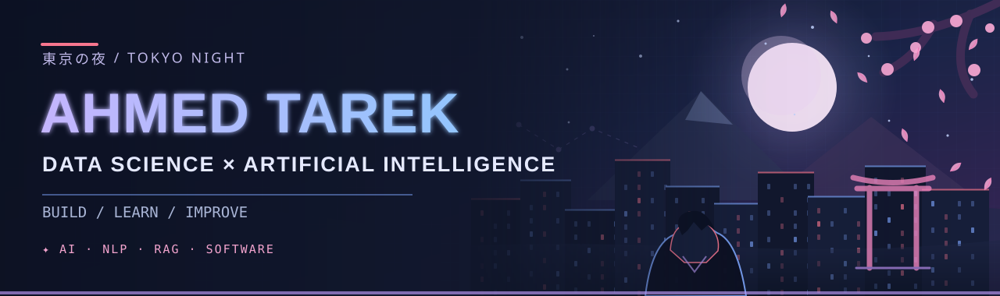

<div align="center">



<br/>


<br/>

[](https://github.com/AhmedTarekOfficial)
[](https://github.com/AhmedTarekOfficial?tab=repositories)


</div>

### 🌙 01 // The person behind the code

I'm **Ahmed Tarek**, a **Computer Science student specializing in Data Science & AI** at **Elsewedy University of Technology** in Egypt.

I like turning ideas into working applications, especially projects involving **machine learning, NLP, retrieval-augmented generation (RAG)** and intelligent workflows. My repositories include experiments, learning projects and applications at different stages of development.

```python
about_me = {
    "focus": ["Data Science", "AI", "NLP", "RAG"],
    "exploring": ["AI Agents", "Deep Learning", "Orchestration"],
    "mindset": "Learn the fundamentals. Build. Iterate."
}
```

<div align="center">

</div>

### ⚡ 02 // My toolkit

**Languages & data**


**AI, backend & developer tools**


<sub>These are tools I've used in projects, coursework or hands-on learning — not a claim of expert proficiency in every tool.</sub>

<div align="center">

</div>

### 🏮 03 // Projects from my world

| Project | Focus |
|:---|:---|
| **[AI Content Operational — Skip Studio](https://github.com/AhmedTarekOfficial/Ai-content-operational-)** | AI-assisted campaign brief summaries and content plans grounded in brand guidelines, with review workflows |
| **[Interactive Safety Workspace Platform](https://github.com/AhmedTarekOfficial/Interactive-Safety-Workspace-platform)** | Workplace safety and employee training management using Java, Spring Boot and MySQL |
| **[Religion RAG App](https://github.com/AhmedTarekOfficial/Religion-rag-app)** | RAG-focused exploration for religious information |
| **[Extract Specifications](https://github.com/AhmedTarekOfficial/Extract_Specifications)** | Specification extraction project |
| **[Talking Plant](https://github.com/AhmedTarekOfficial/TalkingPlantt)** | IoT plant monitoring work |
| **[Game Screen Translator](https://github.com/AhmedTarekOfficial/Game-screen-translator)** | Game-screen translation experiment |

*Project descriptions reflect documented repositories and previously shared project context. A repository's presence doesn't imply a deployed, production-ready product.*

<div align="center">

</div>

### 🎓 04 // Experience & ongoing learning

- **Computer Science · Data Science & AI** — Elsewedy University of Technology
- **Generative AI internship** — Worked on retrieval-based AI applications, focusing on grounded answers, orchestration and guardrails
- **IBM Data Engineering course** — Completed
- **Learning focus** — NLP, data cleansing, machine learning, deep learning, and AI system design

<div align="center">

</div>

### 📊 05 // GitHub activity

<div align="center">


<sub>Third-party statistics cards may occasionally be unavailable. Language distribution reflects repository code, not skill proficiency.</sub>


### 🌸 「継続は力なり」

*Consistency is strength.*

**Learn deeply · Build thoughtfully · Keep improving**

[](https://github.com/AhmedTarekOfficial?tab=repositories)

</div>
